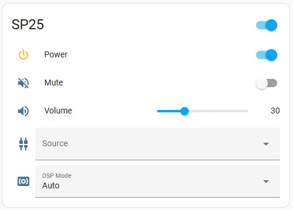
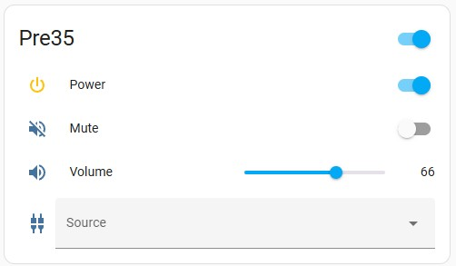

# Primare

Unofficial HA Custom Integration for Primare devices.
 Works only with X5 Serie Models.

<B>Multichannel:</B>
 - SP25
 - SPA25

<B>Stereo:</B>
 - I15 Prisma
 - I25 Prisma
 - I35 Prisma
 - SC15 Prisma
 - Pre35 Prisma

<B>Streamer:</B>
 - NP5
 - NP5 MKII
 

<B> 5 Entities:</B>

- Power on/off
- Mute on/off 
- Volume
- Input select
- DSP Mode Select (only Multichannel devices)
  
 
 

# Manual Installation

1. Navigate to the [Primare](https://github.com/Sulzburg/primare/tree/main/custom_components/primare) directory.
1. Copy the entire `primare` folder, including subfolders, to your Home Assistant `/custom_components/` directory. The historical ZIP does not include the playback platform. If custom_components does not exist, create it.
1. Restart Home Assistant.
1. Just go to `Configuration` -> `Integrations` -> `Add Integration` and search for `Primare`.
1. You will be asked for the <B>fixed IP address</B> of your Primare device.
1. You will be asked for a name of your Primare device ('name' is part of the entity-ID like `switch.'name'_power`, `number.'name'_volume`).
1. Select Multichannel or Stereo device.
1. Hit OK.
1. You will find the following entities:
 - switch.`name`_power
 - switch.`name`_mute
 - number.`name`_volume
 - select.`name`_input
 - select.`name`_dsp_mode.

That's it.

## Optional local playback status

In **Settings → Devices & services → Primare → Configure**, turn on **Enable local media player**. Changing this option reloads the integration automatically. This adds a local media player for the existing Primare entry. You can use its `playing` state in an automation, including when someone starts Spotify Connect using their own account.

The entity reports the title, artist, album, cover art, duration, and playback position when the streamer provides them. It can play or resume, pause, stop, skip tracks, and seek within a track; the available controls depend on the active source. For example, Spotify Connect pauses and keeps the session when it receives Stop. The state attributes `audio_format`, `sample_rate_hz`, `bit_depth`, and `bit_rate_bps` describe what the streamer reports for the stream; they do not measure the digital output after resampling.

Verified with Spotify Connect on an NP5 Prisma MK2. The feature uses the streamer's local LUCI protocol on TCP port 7777; it is off by default because other models or firmware may not expose the same data. Turning the option off removes the playback entity; turn it back on before using that entity in an automation. Playback status does not require Spotify credentials and does not change how the existing Primare controls work.

<B>Hints:</B>

If you want to rename the inputs:
open `custom_components/primare/const.py` with the file editor and replace the names.
e.g.:

`   1: “Preset1”, `  ->  `   1: “BluRay”, `

if you want to exclude an entry, place a # in front of the corresponding line.
e.g.:

`#  7: "SAT/Receiver",`

Hit save.

Restart HA to take effect.

